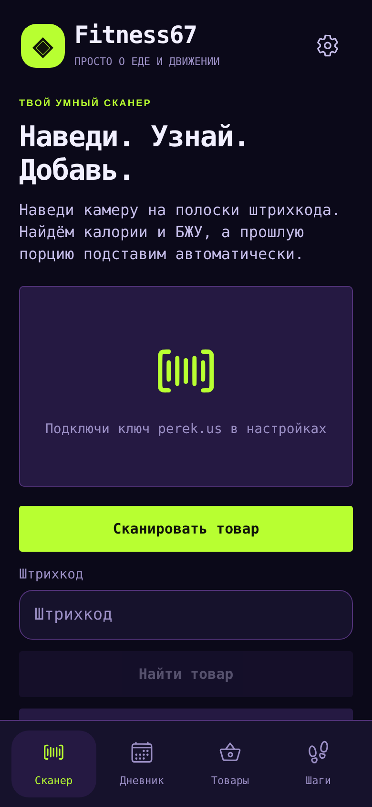
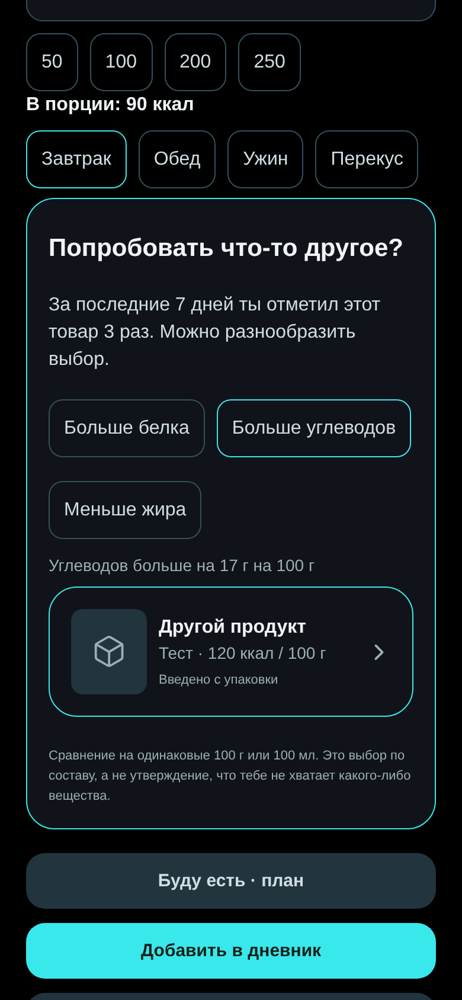
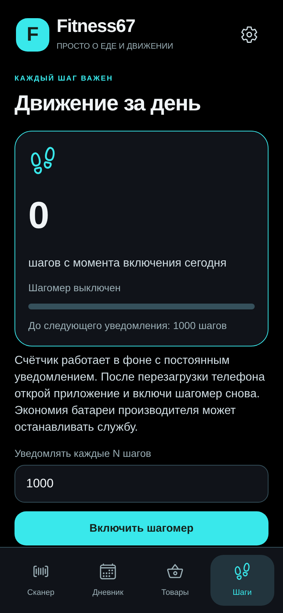

# Fitness67

Учебное приложение для Android: сканирование штрихкодов продуктов, калории и БЖУ, дневник питания, история товаров и шагомер. Интерфейс написан на React Native / Expo; хранение личного ключа и шагомер реализованы нативно для Android на Kotlin.

## Скачать приложение

- [Скачать APK для Android](https://github.com/Ilatrion/Fitness67/raw/refs/heads/main/downloads/Fitness67-v0.6.apk)
- [Скачать проект Android Studio](https://github.com/Ilatrion/Fitness67/raw/refs/heads/main/downloads/Fitness67-v0.6-AndroidStudio.zip)
- [Инструкция PDF](downloads/Fitness67-v0.6-guide.pdf)
- [Скриншоты PDF](downloads/Fitness67-v0.6-screenshots.pdf)

Готовые файлы находятся в папке `downloads`. Описание версии — в [Releases](https://github.com/Ilatrion/Fitness67/releases/latest).

APK устанавливается на Android 7.0 и новее. Для обновления ставьте поверх предыдущей версии, не удаляя приложение. Это учебная сборка со стандартным debug-ключом подписи; для публикации в Google Play нужен собственный release-ключ.

## Возможности

- Сканер EAN/UPC и ручной ввод штрихкода.
- Карточка продукта: фото при наличии в источнике, калории и БЖУ на 100 г или 100 мл.
- Онлайн-поиск Open Food Facts; дополнительный поиск perek.us при своём ключе. Встроенная стартовая выборка — 278 карточек из USDA и Open Food Facts, не полный мировой каталог.
- Дневник: план и съедено, порции, запоминание последней порции, избранное, повтор вчерашнего приёма пищи.
- Подбор альтернатив по белкам, жирам или углеводам из сохранённых товаров, без нейросети.
- Android-шагомер с датчиком TYPE_STEP_COUNTER и foreground-службой, уведомления через выбранное число шагов.
- Семь тем с отдельным экраном выбора: минимализм, тёмный неон, природа, аниме, ретро, iOS и киберпанк.
- Локальное хранение и экспорт дневника в JSON.

## Как пользоваться

1. Установите APK по ссылке выше и откройте Fitness67.
2. Разрешите камеру, физическую активность и уведомления для соответствующих функций. Дневник доступен и без этих разрешений.
3. Для perek.us сохраните свой ключ в настройках. OpenAI не используется. Без ключа доступны история, встроенные карточки и Open Food Facts.
4. Сканируйте товар, проверьте порцию, выберите приём пищи и нажмите «Добавить в дневник».
5. В разделе «Шаги» включите счётчик и задайте интервал уведомлений. Настройки → Оформление → Выбрать тему меняет всё приложение.

Полная [инструкция](Инструкция-Fitness67.md) и [техническое описание](docs/TECHNICAL.md).

## Скриншоты

Это **веб-предпросмотр с примерными записями**, не фотографии работающего датчика Android.

| Тема «Киберпанк» | Подбор продуктов | Экран шагов |
| --- | --- | --- |
|  |  |  |

## Запуск исходников

Нужен Node.js LTS.

```bash
npm ci
npm run typecheck
npm test
npm run web
```

`npm ci` создаёт локальный файл конфигурации с пустым ключом по умолчанию. Для Android откройте папку `android` в Android Studio. Нужны JDK 21, Android SDK 37, Build Tools 37.0.0, min SDK 24.

```bash
cd android
./gradlew assembleRelease
```

Windows: `gradlew.bat assembleRelease`. APK появится в `android/app/build/outputs/apk/release/app-release.apk`.

### Личный ключ из переменной

Можно задать `PEREK_API_KEY` в окружении компьютера или локальном `.env` по `.env.example`, затем выполнить:

```bash
node scripts/catalog-key.mjs
```

После этого пересоберите приложение. Переменная подставляется **при сборке**, а не читается телефоном с компьютера. Встроенный ключ можно извлечь из APK/веб-бандла — используйте этот способ только для личной сборки. В публичных исходниках и приложенном APK личного ключа нет. `.env` и сгенерированный `src/catalogBuild.ts` исключены из Git. Для публичного продукта ключ поставщика должен храниться на сервере; браузерные запросы также могут ограничиваться CORS.

## Проверки и ограничения

- TypeScript, тесты разбора каталогов и рекомендаций, браузерные сценарии дневника/тем пройдены; Android APK собран, подпись проверена.
- Успешный запрос с настоящим личным ключом perek.us не выполнялся. Работа датчика и уведомлений на физическом телефоне ещё требует проверки.
- Шаги считаются с включения; предыдущие шаги дня не восстанавливаются. Нужен аппаратный датчик. После перезагрузки включите счётчик снова. Энергосбережение производителя и разрешения могут влиять на фон и уведомления.
- iOS и браузер не поддерживают нативный шагомер и защищённое Android-хранилище этой версии.
- Точность и покрытие пищевых данных зависят от источника. Сверяйте состав с упаковкой. Программа не диагностирует дефициты и заболевания.
- Из старого дневника автоматически переносятся записи с известным весом; прежнее хранилище сохраняется отдельно. Импорт нового JSON в интерфейс 0.6 не реализован.

## Источники данных

[USDA FoodData Central](https://fdc.nal.usda.gov/) — CC0. [Open Food Facts](https://world.openfoodfacts.org/) — ODbL/DbCL, изображения CC BY-SA. [perek.us](https://perek.us/developers) — доступ со своим ключом и по условиям поставщика; атрибуция показана в карточках. Лицензии и условия данных не заменяются условиями исходного кода приложения.
